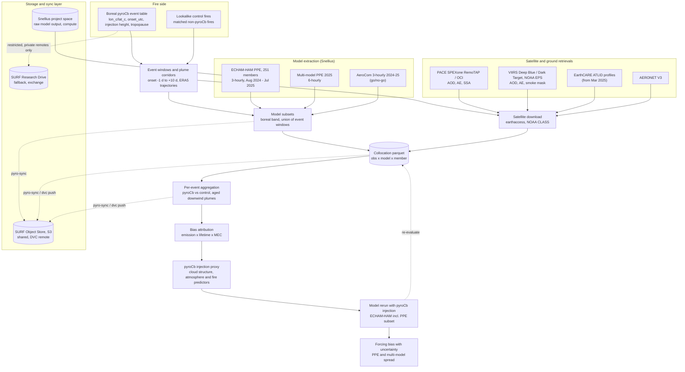

# pyro

This project compares pyroCb and matched non-pyroCb fires in AeroCom and multi-model PPE output against satellite observations. The goal is to quantify the model bias and forcing from missing pyroCb injection, starting with a boreal pilot (Alaska, Canada, Siberia).

Aerosol side: Jessie Zhang (VU Amsterdam). Fire side (event detection and matching): Jelle Kraak (VU Amsterdam).

> **Status:** planning and scaffold. Step 1 is model and satellite preparation around the 2024 boreal event list. The sync tool and the event-table utilities work; the extraction, download and collocation modules are planned in [`docs/pipeline_plan.md`](docs/pipeline_plan.md).

## Project flowchart



TROPOMI aerosol products are not used.

## Repository layout

| Path | What |
|---|---|
| `docs/data_inventory.md` | What 2024–25 PPE / AeroCom / observation data exists on Snellius, and the gaps |
| `docs/pipeline_plan.md` | Step 1 plan: event windows, model subsetting, satellite download, collocation to parquet |
| `docs/storage_and_sync.md` | Storage comparison, recommendation, sync tool and DVC usage, licensing rules |
| `docs/environment.md` | Devcontainer / Docker / Apptainer (Snellius, ADA) / Kubernetes |
| `src/pyro/sync.py`, `scripts/sync.sh` | `pyro-sync`: rclone-based, config-driven sync (dry-run default) |
| `src/pyro/events.py` | `pyro-events`: event-table validation, windows, period coverage |
| `config/` | `sync.toml` (datasets, remotes), `*.example` templates; `local.env` is gitignored |
| `Dockerfile`, `.devcontainer/`, `containers/`, `k8s/` | Portable environment |
| `.dvc/` | DVC remotes (placeholders; real URLs go in `.dvc/config.local`) |

## Quick start

```bash
uv sync --all-extras                      # or: open in Codespaces / devcontainer
cp config/local.env.example config/local.env   # machine paths only, gitignored
uv run pytest
uv run pyro-events coverage "$PYRO_DATA_ROOT/events/<event_table>.csv"
scripts/sync.sh remotes                   # which storage remotes are configured
scripts/sync.sh push model_subsets -r surf_s3   # dry run
```

## Data and credentials policy

- No data in git. Event tables, lookalike controls and event-keyed products are **restricted**: keep them under `$PYRO_DATA_ROOT`, sync them only to private remotes, and never publish them before both sides agree. GLD360 lightning data is licensed and never synced.
- No credentials in files. NASA Earthdata, Copernicus ADS/CDS and storage keys come from environment variables or Codespaces/CI secrets (`config/remotes.env.example` lists the names).
- Snellius paths, project and account names go in `config/local.env`, not in committed files.

## Related code

- [AeroCom_Error](https://github.com/jessieaha/AeroCom_Error): PPE/AeroCom readers and the emission × lifetime × MEC AOD error split (regional / monthly). Step 1 extends this with an event-based layer.
- [CAMEL-PACE](https://github.com/jessieaha/CAMEL-PACE): PACE SPEXone L2 to parquet; the satellite extraction reuses its pattern.
- [PyroCB](https://github.com/JJJellyyy/PyroCB): fire-side event matching (FireAtlas). It defines the event-table conventions.
