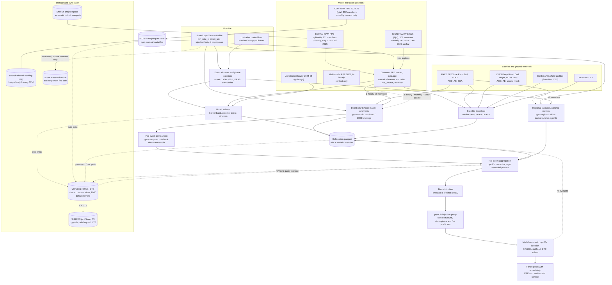
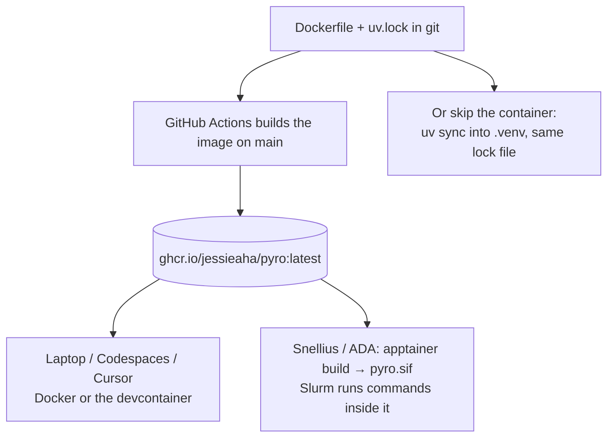

# pyro

This project compares pyroCb and matched non-pyroCb fires in AeroCom and multi-model PPE output against satellite observations. The goal is to quantify the model bias and forcing from missing pyroCb injection, starting with a boreal pilot (Alaska, Canada, Siberia).

Aerosol side: Jessie Zhang (VU Amsterdam). Fire side (event detection and matching): Jelle Kraak (VU Amsterdam).

> **Status:** step 1 in progress. Working: the sync tool (Google Drive / S3 / Research Drive), event-table utilities, event × SPEXone matching with PPE sampling (`pyro-match`), a common reader for the ECHAM-HAM and ICON-HAM PPEs (`pyro-ppe`), the ICON-HAM PPE parquet store (`pyro-icon`), in-place parquet queries (`pyro-query`), per-event observation-vs-ensemble comparison (`pyro-compare`, `notebooks/event_comparison.ipynb`) and regional AeroVal statistics for pyroCb vs background scenes (`pyro-regional`). Corridors, VIIRS download and full collocation are planned in [`docs/pipeline_plan.md`](docs/pipeline_plan.md). All tables use polars.

## Project flowchart



TROPOMI aerosol products are not used.

## How the code runs

One recipe (`Dockerfile`) and one pinned package list (`uv.lock`) produce one environment. GitHub builds it into an image; a laptop runs that image with Docker; Snellius has no Docker, so Apptainer converts the same image into a single file and runs it. The full guide, written for someone new to containers, is [`docs/environment.md`](docs/environment.md).



The image holds Python, the libraries and tools (`cdo`, `rclone`). It does not hold data or passwords: GPFS folders are handed in with `--bind`, and paths live in the gitignored `config/local.env`. On Snellius today the `.venv` route is enough; the `.sif` route is for batch jobs that must match the published image exactly.

## Repository layout

| Path | What |
|---|---|
| `docs/data_inventory.md` | What 2024–25 PPE / AeroCom / observation data exists on Snellius, and the gaps |
| `docs/pipeline_plan.md` | Step 1 plan: event windows, model subsetting, satellite download, collocation to parquet |
| `docs/storage_and_sync.md` | Storage comparison, recommendation, sync tool and DVC usage, licensing rules |
| `docs/environment.md` | Container setup explained from scratch: Docker, devcontainer, Apptainer on Snellius, `.venv` |
| `src/pyro/sync.py`, `scripts/sync.sh` | `pyro-sync`: rclone-based, config-driven sync (dry-run default) |
| `src/pyro/events.py` | `pyro-events`: event-table validation, windows, period coverage |
| `src/pyro/match.py` | `pyro-match`: all events × SPEXone pixels, super-obs, PPE sampling through `pyro.ppe` (all members) |
| `src/pyro/ppe.py`, `config/ppe_sources.toml` | `pyro-ppe`: one reader/adapter for both PPEs (ybhatti ECHAM-HAM, hjia ICON-HAM) with a common schema |
| `src/pyro/compare.py`, `notebooks/event_comparison.ipynb` | `pyro-compare`: per-event SPEXone super-obs vs ensemble median / 5–95 % / control, metrics and figures |
| `src/pyro/regional.py`, `config/regions.toml` | `pyro-regional`: AeroVal statistics per region for the regional average, background and pyroCb-affected scenes, per member |
| `src/pyro/icon_ppe.py` | `pyro-icon`: ICON-HAM PPE netCDF → partitioned parquet store, with verification |
| `src/pyro/store.py` | `pyro-query`: polars queries on local parquet or in place on Drive via `rclone serve s3` |
| `scripts/gdrive_setup.sh` | Link the VU Google Drive to rclone, or repair a remote saved without token (token stays outside the repo) |
| `scripts/apptainer_kernel.sh` | Jupyter kernel that runs inside the Apptainer image |
| `scripts/scratch_keepalive.sh` | Single self-resubmitting job that refreshes scratch every 12 days |
| `config/` | `sync.toml` (datasets, remotes), `*.example` templates; `local.env` is gitignored |
| `Dockerfile`, `.devcontainer/`, `containers/`, `k8s/` | Portable environment |
| `.dvc/` | DVC remotes (placeholders; real URLs go in `.dvc/config.local`) |

## Quick start

```bash
uv sync --all-extras                      # or: open in Codespaces / devcontainer
cp config/local.env.example config/local.env   # machine paths only, gitignored
uv run pytest
uv run pyro-events coverage "$PYRO_DATA_ROOT/events/<event_table>.csv"
scripts/sync.sh remotes                   # which storage remotes are configured
scripts/gdrive_setup.sh                   # once: link the VU Google Drive
scripts/sync.sh push icon_ppe -r gdrive   # dry run
uv run pyro-ppe list                      # configured PPE sources
uv run pyro-match "$PYRO_DATA_ROOT/events/<event_table>.csv"
uv run pyro-compare                       # per-event figures from the pyro-match output
uv run pyro-regional "$PYRO_DATA_ROOT/events/<event_table>.csv"   # regional statistics
```

## Data and credentials policy

- No data in git. Event tables, lookalike controls and event-keyed products are **restricted**: keep them under `$PYRO_DATA_ROOT`, sync them only to private remotes, and never publish them before both sides agree. GLD360 lightning data is licensed and never synced.
- No credentials in files. NASA Earthdata, Copernicus ADS/CDS and storage keys come from environment variables or Codespaces/CI secrets (`config/remotes.env.example` lists the names).
- Snellius paths, project and account names go in `config/local.env`, not in committed files.

## Related code

- [AeroCom_Error](https://github.com/jessieaha/AeroCom_Error): PPE/AeroCom readers and the emission × lifetime × MEC AOD error split (regional / monthly). Step 1 extends this with an event-based layer.
- [CAMEL-PACE](https://github.com/jessieaha/CAMEL-PACE): PACE SPEXone L2 to parquet; the satellite extraction reuses its pattern.
- [PyroCB](https://github.com/JJJellyyy/PyroCB): fire-side event matching (FireAtlas). It defines the event-table conventions.
