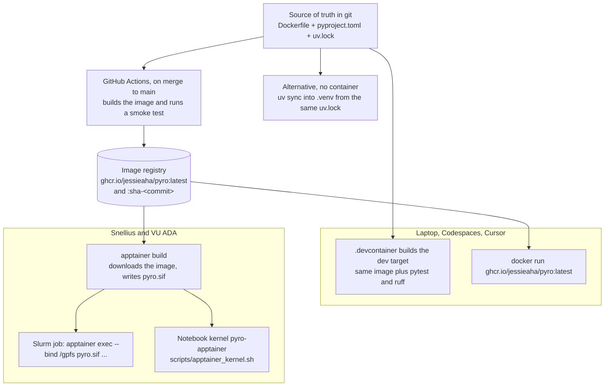

# How the code runs

This page is the setup guide. It assumes no previous experience with containers.

The short version: the project has **one recipe** (`Dockerfile`) and **one list of exact package versions** (`uv.lock`). GitHub builds a container image from those. A laptop runs that image with Docker. Snellius and VU ADA cannot run Docker, so they convert the same image into one file (`pyro.sif`) and run it with Apptainer. A third option, used on Snellius today, skips the container and installs the same packages into `.venv`.

## What a container is

A container is a small, self-contained Linux system packed into one file: its own Python, its own libraries, and the command-line tools this project needs (`cdo`, `nco`, `ncdump`, `rclone`). When you start it, those programs run, and they do not use whatever happens to be installed on the machine around them.

That matters here because the same analysis has to run in four places that are set up differently:

| Place | What is installed there | How this project runs |
|---|---|---|
| Your laptop | whatever you installed | Docker, or a local `.venv` |
| GitHub Codespaces / Cursor "Reopen in Container" | a blank cloud machine | Docker, from `.devcontainer/` |
| Snellius, VU ADA | shared modules (`module load`), no Docker allowed | Apptainer, or a local `.venv` |
| A Kubernetes cluster (not used for step 1) | containers only | the same image, see [`../k8s/README.md`](../k8s/README.md) |

Without a container, "it works on my laptop" and "it fails on Snellius" is the normal outcome: different Python versions, different netCDF libraries, a missing `cdo`. With one image, all four places run the same bytes.

Two things a container does **not** do:

- It does not contain the data. Event tables, PPE files and outputs stay on disk (GPFS, scratch, Google Drive). The container only sees a folder if you explicitly hand it over, called a *bind*. `scripts/slurm/run_step.sbatch` binds `/projects`, `/gpfs` and `/scratch-shared`.
- It does not contain secrets or machine paths. Tokens stay in environment variables. Snellius paths stay in `config/local.env`, which is gitignored and read from the host.

## The pieces, and how an image gets to Snellius



Reading that top to bottom:

1. `pyproject.toml` names the Python packages (polars, xarray, ipykernel, …). `uv.lock` pins every package to an exact version, so a rebuild in six months installs the same ones. `Dockerfile` is the recipe: start from Debian with Python 3.12, install `cdo`, `nco`, `rclone`, then install the locked packages into `/opt/venv` inside the image.
2. GitHub Actions (`.github/workflows/container.yml`) builds that recipe when commits land on `main` or on a `v*` tag, checks that `import pyro` and `pyro-sync --help` work, and uploads the image to GitHub's container registry, `ghcr.io/jessieaha/pyro`. Pull requests that touch the recipe build the image and run the same check, but do not upload it.
3. Two tags are published. `:latest` always means the newest `main`. `:sha-<commit>` never moves; use it when a result has to be reproducible.
4. On a laptop, Docker downloads and runs the image. In Cursor or Codespaces, "Reopen in Container" builds the `dev` target of the same recipe, which adds the test tools (pytest, ruff).
5. On Snellius there is no Docker. Apptainer downloads the same image and saves it as one file, `pyro.sif`. A Slurm job then runs a command *inside* that file. The file is large and is not committed (`.gitignore` excludes `*.sif`).

The image has two build targets:

| Target | Used by | Extra contents |
|---|---|---|
| `runtime` (the default) | the published image, Apptainer, batch jobs | everything needed to run the pipeline |
| `dev` | `.devcontainer`, `docker build --target dev` | the above, plus pytest and ruff |

Inside, a Linux user named `pyro` (uid 1000) owns the files. Apptainer ignores that and runs as *your* Snellius user, so files the job writes are yours.

## What is installed

- Python 3.12 and the packages in `uv.lock`. Core: numpy, polars, pyarrow. `analysis` extra: xarray, netCDF4, h5netcdf, h5py, dask, scipy, pyproj, shapely, earthaccess, cdsapi, s3fs, matplotlib. `notebook` extra: ipykernel, registered as the Jupyter kernel `pyro` ("pyro (container)"). `dvc` extra: dvc with s3, webdav and ssh support.
- Command-line tools: `cdo`, `nco`, `ncdump` (`netcdf-bin`), `rclone`, `git`, `curl`.
- Commands: `pyro-sync`, `pyro-events`, `pyro-match`, `pyro-ppe`, `pyro-icon`, `pyro-query`, `pyro-compare`, `pyro-regional`.

## Which setup to use

| You want to… | Use |
|---|---|
| Try a command on Snellius today | the repo `.venv` (below). No image build needed |
| Run a notebook in Cursor on Snellius | the `.venv` kernel. Pick "pyro" |
| Guarantee a batch job uses the published environment | Apptainer, after the image exists on `main` |
| Work on a laptop that should match CI | Docker or the devcontainer |
| Edit code with tests and linting in the editor | devcontainer, or `uv sync --all-extras` locally |

## Setup A. Local virtual environment (Snellius today)

This installs the locked packages into `.venv` inside the clone. It is the same list the image installs. It does not involve Docker or Apptainer.

```bash
# Snellius has no uv module. Once per account:
python3 -m pip install --user uv          # lands in ~/.local/bin

cd ~/pyro
~/.local/bin/uv sync --all-extras         # creates .venv
source .venv/bin/activate
cp config/local.env.example config/local.env   # then fill in the real paths
pytest -q
pyro-ppe list
```

Run notebooks and heavy jobs on a compute node (`salloc`, or Open OnDemand), not on the login node.

Adding a package:

```bash
uv add <package>            # or edit pyproject.toml, then:
uv lock                     # resolve versions into uv.lock
uv sync --all-extras        # install locally
uv run pytest
```

Commit both `pyproject.toml` and `uv.lock`. CI rejects a lock file that does not match (`uv lock --check`).

## Setup B. Apptainer on Snellius or VU ADA

Do this once per image version, after the image has been published from `main`. Downloading happens on a login node; the cache goes to scratch, not `$HOME`.

```bash
module purge                              # host modules break the container's libraries
export PYRO_SIF=$HOME/containers/pyro.sif
scripts/apptainer_build.sh                # downloads ghcr.io/jessieaha/pyro:latest
# pin a build instead: PYRO_IMAGE_TAG=sha-<commit> scripts/apptainer_build.sh

# run one command inside it. --bind is how it sees GPFS
apptainer exec --bind /projects,/gpfs,/scratch-shared "$PYRO_SIF" pyro-ppe list

# a batch job. The wrapper does the bind and sets HDF5_USE_FILE_LOCKING=FALSE
sbatch --account="$PYRO_SLURM_ACCOUNT" scripts/slurm/run_step.sbatch \
    pyro-events coverage "$PYRO_DATA_ROOT/events/<table>.csv"
```

`containers/pyro.def` is a thin wrapper around the same image: it sets `HDF5_USE_FILE_LOCKING=FALSE` (netCDF on GPFS fails intermittently otherwise) and defines `apptainer test pyro.sif`, which checks that pyro, ipykernel, rclone and cdo all work.

Practical rules:

- Run `module purge` first, and do not `module load 2025` in the same shell. The container brings its own Python, HDF5, netCDF and CDO. A loaded module prepends the host's libraries and the container's programs stop working.
- Apptainer passes your environment variables in, so `EARTHDATA_TOKEN`, `RCLONE_CONFIG_*` and the variables from `config/local.env` reach the command. `--cleanenv` drops them; only the notebook kernel uses it, and the notebook re-reads `local.env` itself.
- A folder is invisible inside the container until it is in `--bind`. Add more with `PYRO_BIND`.
- `ghcr.io/jessieaha/pyro` may be a private package. If `apptainer build` is denied, either make the package public (it holds no data and no secrets) or log in: `apptainer remote login --username <github-user> docker://ghcr.io` with a read-only token.
- `pyro-sync` does not need the container. `scripts/sync.sh` uses `.venv` or `python3.12` plus the system `rclone`, which is also what `--slurm` submissions use.

### Notebooks inside the container

```bash
scripts/apptainer_kernel.sh install "$PYRO_SIF"
```

This writes `~/.local/share/jupyter/kernels/pyro-apptainer/kernel.json`. In Cursor, VS Code or JupyterLab, choose the kernel **pyro (apptainer)**. Each cell then runs inside the image, with `/gpfs`, `/projects` and `/scratch-shared` visible (`PYRO_APPTAINER_BIND` changes that list). The image must contain `ipykernel`, which it does for images built from `main` after the `notebook` extra was added; rebuild the `.sif` after that.

Notebook outputs name events, so they are restricted. `.gitattributes` strips them on `git add`. Enable that once per clone:

```bash
git config filter.nbstrip.clean "python3 scripts/nbstrip.py"
```

Your working copy keeps the outputs; only the committed copy is emptied. `tests/test_notebooks.py` checks the committed copy.

## Setup C. Docker on a laptop, or a devcontainer

```bash
docker build -t pyro:latest .                              # runtime target
docker build -t pyro:dev --target dev .                    # adds pytest, ruff
docker run --rm -v "$PWD/data:/work/data" pyro:latest pyro-ppe list
```

In Cursor or VS Code: "Reopen in Container". That builds the `dev` target, opens the repo at `/workspaces/pyro`, and points the editor at `/opt/venv/bin/python`. On first start it creates `data/` and runs the tests.

Codespaces reads the same file. Add `EARTHDATA_TOKEN`, `ADS_API_KEY`, `CDS_API_KEY`, `AWS_ACCESS_KEY_ID` and `AWS_SECRET_ACCESS_KEY` as Codespaces secrets (GitHub → Settings → Codespaces → Secrets). They arrive as environment variables and are never written into the repo.

## What GitHub does on each push

- `.github/workflows/ci.yml` runs the linter, the tests (including a real rclone transfer to a local folder) and `uv lock --check`, on `main` and on every pull request.
- `.github/workflows/container.yml` builds the image when the recipe changes. On a pull request it only tests the image. On `main` and on `v*` tags it publishes `ghcr.io/jessieaha/pyro:latest`, `:sha-<commit>` and, for a tag, `:<tag>`.

So a commit on this branch does not change the image Snellius downloads. The image updates when the branch is merged to `main`, and `scripts/apptainer_build.sh` is run again.

## Kubernetes

Not needed for step 1: the model files cannot leave Snellius, and Slurm plus Apptainer covers the jobs. `k8s/` holds example Jobs for the case where the satellite download and collocation later move next to the object store. Details in [`../k8s/README.md`](../k8s/README.md).
